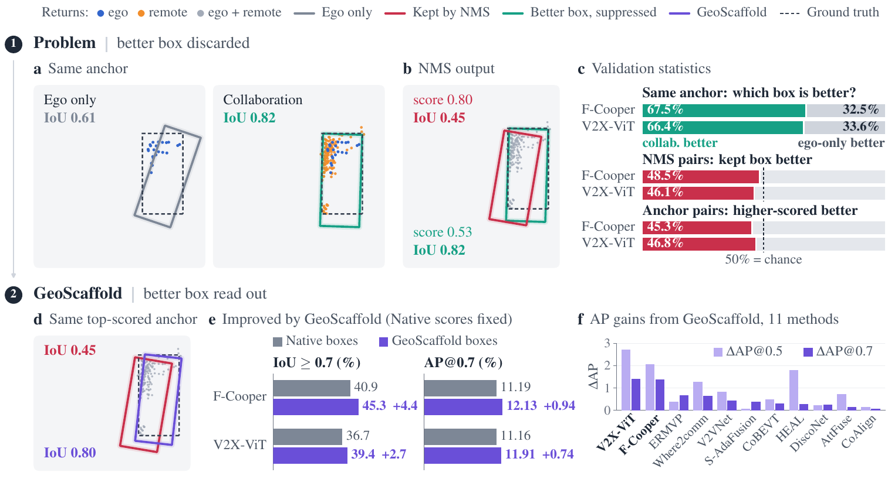
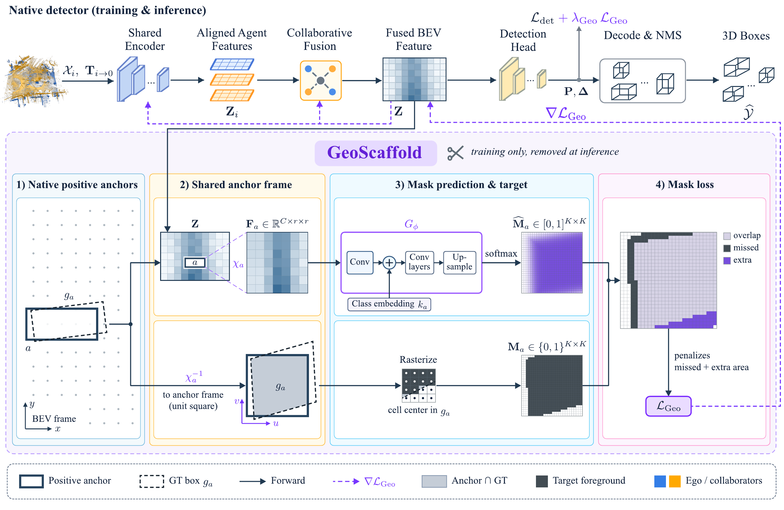

# GeoScaffold: From Latent to Realized Geometry in Collaborative Detection

> **TL;DR:** GeoScaffold is a training-only auxiliary loss for collaborative 3D detectors. At each positive anchor, it predicts which cells of a grid over the anchor lie inside the ground-truth box, and this dense supervision trains the detector toward better-localized boxes. The head is removed at inference, so each detector keeps its architecture, communication, and inference cost. <!-- begin:headline -->Across 11 fusion methods on the UrbanIng-V2X validation split, GeoScaffold raises AP@0.5 by 0.98 and AP@0.7 by 0.55 points on average.<!-- end:headline -->

<p align="center">
  
</p>

<p align="center">
  <b>Paper:</b> arXiv (coming soon) &nbsp;&middot;&nbsp; <b>Model weights:</b> <a href="https://huggingface.co/sidiangongyuan/GeoScaffold">Hugging Face</a>
</p>

<p align="center">
  Kang Yang<sup>1</sup>&nbsp;&nbsp; Yance Fang<sup>1</sup>&nbsp;&nbsp; Gaochen Cui<sup>2</sup>&nbsp;&nbsp; Xiaoqiang Jin<sup>3</sup>&nbsp;&nbsp; Deying Li<sup>1</sup>&nbsp;&nbsp; Yongcai Wang<sup>1</sup><br>
  <sup>1</sup>Renmin University of China&nbsp;&nbsp;&nbsp; <sup>2</sup>CFINS, Tsinghua University&nbsp;&nbsp;&nbsp; <sup>3</sup>QiYuanLab
</p>

## News

- **[2026-11]** Code, configs, training recipes, and [checkpoints](https://huggingface.co/sidiangongyuan/GeoScaffold) for the UrbanIng-V2X benchmark are released. The arXiv link will follow.

## Contents

- [Overview](#overview)
- [Results](#results)
- [Installation](#installation)
- [Data preparation](#data-preparation)
- [Checkpoints](#checkpoints)
- [Evaluation](#evaluation)
- [Training](#training)
- [Repository layout](#repository-layout)
- [License](#license)
- [Acknowledgments](#acknowledgments)
- [Citation](#citation)

## Overview

<p align="center">
  
</p>

Collaborative detectors fuse bird's-eye-view (BEV) features from vehicles and roadside units and read boxes from the fused map with anchor scoring, box decoding, and non-maximum suppression (NMS). The classification score is trained only to separate foreground from background, and when NMS resolves two overlapping collaborative boxes of one object, it keeps the better-localized box less than half of the time. GeoScaffold adds a small head on the fused BEV during training. For every positive anchor, the head samples a 7×7 feature patch aligned with the anchor and predicts a 28×28 mask of the anchor cells that lie inside the ground-truth box. A cross-entropy plus Dice loss on this mask is added to the detection loss and reaches the encoder and fusion modules through the fused BEV. The head is dropped at evaluation.

In the configs, `model.args.geometry_scaffold.enabled` builds the head and `loss.args.geometry_scaffold.weight` sets its loss weight (1.0 for +GeoScaffold, 0.0 for Native). The AttFuse configs express the same switch with `counterfactual_training` (`mode: fused_geoscaffold`, `geoscaffold_weight: 1.0`).

## Results

UrbanIng-V2X validation split (crossing1/2), AP@0.3 / 0.5 / 0.7 in percent, final checkpoints. Each Native/+GeoScaffold pair shares data, seed, sample order, augmentation, optimizer settings, learning-rate schedule, and training length ([docs/training.md](docs/training.md)). Δ is computed before rounding.

<!-- begin:results -->

| Reference detector | AP@0.3 / 0.5 / 0.7 |
|---|---|
| Ego-only | 22.55 / 16.12 / 5.41 |
| Early Fusion | 23.76 / 17.35 / 6.46 |
| Late Fusion | 27.25 / 19.40 / 6.88 |

| Fusion method | Native | +GeoScaffold | Δ |
|---|---|---|---|
| AttFuse | 24.25 / 18.18 / 7.16 | 25.19 / 18.89 / 7.30 | +0.94 / +0.71 / +0.15 |
| F-Cooper | 31.62 / 25.35 / 11.19 | 33.12 / 27.43 / 12.57 | +1.49 / +2.08 / +1.38 |
| CoBEVT | 28.27 / 22.45 / 8.76 | 28.53 / 22.94 / 9.07 | +0.26 / +0.49 / +0.32 |
| Where2comm | 30.21 / 24.89 / 11.13 | 30.90 / 26.16 / 11.78 | +0.68 / +1.27 / +0.65 |
| V2X-ViT | 33.86 / 26.38 / 11.16 | 36.35 / 29.08 / 12.58 | +2.49 / +2.71 / +1.42 |
| V2VNet | 22.84 / 17.11 / 6.65 | 23.48 / 17.95 / 7.07 | +0.64 / +0.84 / +0.43 |
| DiscoNet | 30.64 / 25.52 / 11.37 | 30.84 / 25.75 / 11.61 | +0.21 / +0.24 / +0.25 |
| CoAlign | 28.22 / 19.96 / 7.38 | 28.27 / 20.10 / 7.45 | +0.05 / +0.15 / +0.07 |
| ERMVP | 29.19 / 23.76 / 10.04 | 29.86 / 24.15 / 10.72 | +0.67 / +0.39 / +0.68 |
| HEAL | 26.59 / 20.72 / 9.13 | 28.12 / 22.53 / 9.41 | +1.52 / +1.81 / +0.29 |
| S-AdaFusion | 29.56 / 21.43 / 7.61 | 29.99 / 21.49 / 7.99 | +0.43 / +0.06 / +0.38 |
| Mean over 11 methods | | | +0.85 / +0.98 / +0.55 |

<!-- end:results -->

## Installation

The code was tested with Python 3.9, PyTorch 1.12.0, CUDA 11.3, and spconv 2.3.6 on a single RTX 4090. Run every command from the repository root.

```bash
git clone https://github.com/sidiangongyuan/GeoScaffold.git
cd GeoScaffold

conda env create -f environment.yml
conda activate geoscaffold
conda install pytorch==1.12.0 torchvision==0.13.0 cudatoolkit=11.3 -c pytorch -c conda-forge
python -m pip install -r requirements.txt
python -m pip install spconv-cu113

# Cython extension for box overlaps, used by the post-processor
python opencood/utils/setup.py build_ext --inplace
```

The tools run as modules (`python -m opencood.tools.train`), so the package needs no installation step.

## Data preparation

1. **Download and convert UrbanIng-V2X.** Download the dataset from [Harvard Dataverse](https://dataverse.harvard.edu/dataset.xhtml?persistentId=doi:10.7910/DVN/A9LPY7) and convert it to the OpenCOOD format with the toolkit of the [UrbanIng-V2X repository](https://github.com/thi-ad/UrbanIng-V2X), whose README covers download, extraction, and the toolkit environment:

   ```python
   from urbaning.converters import urbaning_to_opencood_format
   urbaning_to_opencood_format(source_folder="datasets/UrbanIng-V2X",
                               target_folder="datasets/UrbanIng-V2X-OpenCOOD-format")
   ```

2. **Create the split.** Training and validation use crossing1 and crossing2, and testing uses crossing3. The script links the 20 training, 7 validation, and 7 test sequences of the paper (4,000 / 1,400 / 1,400 frames):

   ```bash
   python tools/make_split.py --dataset_dir datasets/UrbanIng-V2X-OpenCOOD-format
   ```

The configs read `datasets/UrbanIng-V2X-OpenCOOD-format/splits/sis/sis_train_crossing1_crossing2_test_crossing3/` relative to the repository root. If the converted data lives elsewhere, link it into place and keep the config paths unchanged, because CoAlign compares this path with the one stored in its alignment files:

```bash
mkdir -p datasets
ln -s /path/to/converted/data datasets/UrbanIng-V2X-OpenCOOD-format
```

## Checkpoints

The 25 checkpoints of the results table (both arms of the 11 fusion methods, plus Ego-only, Early Fusion, and Late Fusion) are on [Hugging Face](https://huggingface.co/sidiangongyuan/GeoScaffold). Download them into the repository root with the `hf` command of `huggingface_hub`:

```bash
python -m pip install -U huggingface_hub
hf download sidiangongyuan/GeoScaffold --local-dir . --include "checkpoints/*"
```

The download creates this layout:

```
checkpoints/urbaning/<method>/<native|geoscaffold>/config.yaml
checkpoints/urbaning/<method>/<native|geoscaffold>/net_epoch<N>.pth
checkpoints/urbaning/coalign/alignment/{train,val}_all_agents.json
```

Each folder holds the final checkpoint of one run with its config. [docs/checkpoints.md](docs/checkpoints.md) lists every folder with its evaluation flags and validation AP. To confirm a complete download, build every model on the CPU and load its weights:

```bash
python tools/check_checkpoints.py
```

## Evaluation

```bash
python -m opencood.tools.inference --model_dir checkpoints/urbaning/v2xvit/geoscaffold --fusion_method intermediate --gpu cuda:0
```

The results go to `<model_dir>/val/eval_3d_det.yaml`, whose entries `mAP_0-100_0.3`, `mAP_0-100_0.5`, and `mAP_0-100_0.7` are the class-averaged AP values of the results table. Early Fusion and Late Fusion use `--fusion_method early` and `--fusion_method late`. Ego-only is scored against the same collaborative ground truth as the fusion methods, and `--gt_config` names the config that defines it:

```bash
python -m opencood.tools.inference --model_dir checkpoints/urbaning/ego_only/native --fusion_method nofusion --gt_config configs/urbaning/fcooper/native.yaml --gpu cuda:0
```

- DiscoNet builds its Early Fusion teacher from `checkpoints/urbaning/early_fusion/native/net_epoch20.pth`, so that checkpoint must be present.
- CoAlign reads its stage-1 box-alignment results from `checkpoints/urbaning/coalign/alignment/`.
- Evaluation shuffles the input points of each frame, which changes the points that the voxelizer keeps. The F-Cooper, V2X-ViT, CoAlign, and HEAL configs set `evaluation_seed`, which fixes this shuffle per frame as in the reported evaluations. The other methods were evaluated without it, so a re-run can differ slightly from the table.

## Training

Most pairs train a shared Native prefix; both arms then resume from its last checkpoint with fresh optimizers. F-Cooper trains both arms from scratch, as do the reference detectors. [docs/training.md](docs/training.md) gives the schedule of every method and the commands. A CoBEVT pair, for example:

```bash
python -m opencood.tools.train --hypes_yaml configs/urbaning/cobevt/prefix.yaml --seed 1669408686
PREFIX=$(ls -d opencood/logs/lidar/cobevt_prefix_* | tail -n 1)
for ARM in native geoscaffold; do
  mkdir -p runs/cobevt/$ARM
  cp configs/urbaning/cobevt/$ARM.yaml runs/cobevt/$ARM/config.yaml
  cp $PREFIX/net_epoch11.pth runs/cobevt/$ARM/
  python -m opencood.tools.train --hypes_yaml runs/cobevt/$ARM/config.yaml \
      --model_dir runs/cobevt/$ARM --seed 1669408686
done
```

## Repository layout

```
configs/urbaning/<method>/    native.yaml, geoscaffold.yaml, prefix.yaml (CoAlign adds prefix_stage2.yaml)
opencood/                     OpenCOOD-based package: datasets, models, losses, training and inference
  models/sub_modules/geometry_scaffold.py   GeoScaffold head and anchor-aligned feature sampling
  data_utils/geoscaffold.py                 mask targets for positive anchors
  loss/point_pillar_loss.py                 detection loss with the GeoScaffold mask loss
tools/                        make_split.py, check_checkpoints.py
docs/                         training.md, checkpoints.md
third_party_licenses/         licenses of code from other projects
```

## License

The code builds on OpenCOOD and keeps its UCLA Academic Software License ([LICENSE](LICENSE)), which covers academic and non-profit research use. Code from other projects keeps its own license; [third_party_licenses/](third_party_licenses/README.md) lists these files. The UrbanIng-V2X dataset is released by its authors under CC BY-NC-ND 4.0.

## Acknowledgments

This repository builds on [OpenCOOD](https://github.com/DerrickXuNu/OpenCOOD) and the OpenCOOD integration of [UrbanIng-V2X](https://github.com/thi-ad/UrbanIng-V2X). The fusion methods follow the papers and code of [V2X-ViT](https://github.com/DerrickXuNu/v2x-vit), [CoBEVT](https://github.com/DerrickXuNu/CoBEVT), [Where2comm](https://github.com/MediaBrain-SJTU/Where2comm), [DiscoNet](https://github.com/ai4ce/DiscoNet), [CoAlign](https://github.com/yifanlu0227/CoAlign), [ERMVP](https://github.com/Terry9a/ERMVP), [HEAL](https://github.com/yifanlu0227/HEAL), and [S-AdaFusion](https://github.com/DonghaoQiao/Adaptive-Feature-Fusion-for-Cooperative-Perception); AttFuse, F-Cooper, and V2VNet use their OpenCOOD implementations. We thank the authors for releasing their code and data.

## Citation

The BibTeX entry will be added with the arXiv version.
